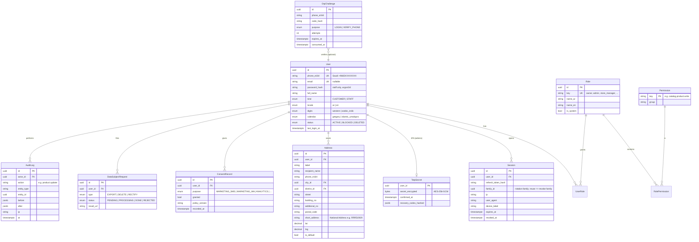
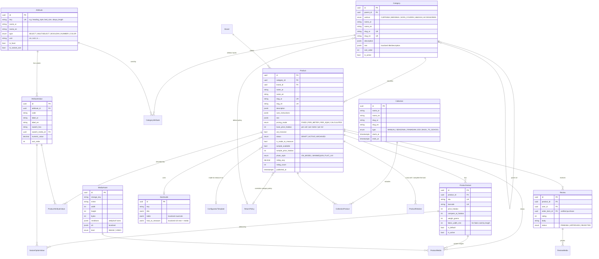
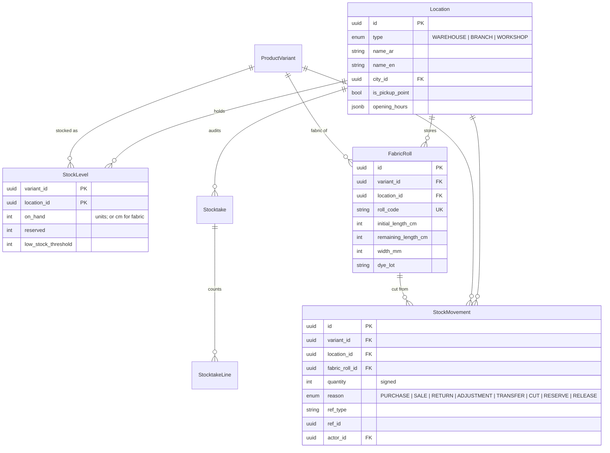
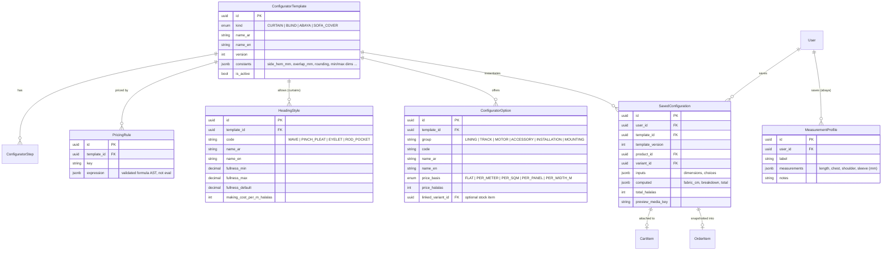
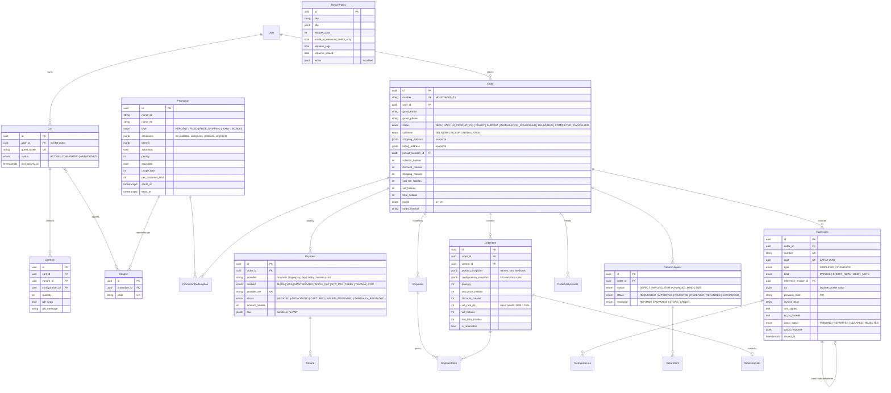
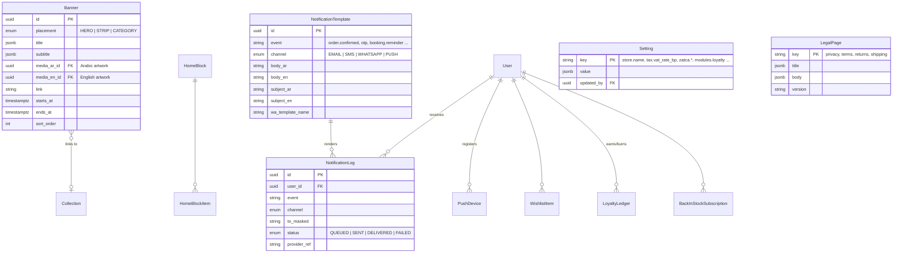

# Entity-Relationship Design

Conventions used across all tables:

- Primary keys are `uuid` (v7, time-ordered) named `id`.
- Every table has `created_at` / `updated_at` (`timestamptz`); soft-deletable aggregates add `deleted_at`.
- **Bilingual text** is stored as two columns, `*_ar` / `*_en`, for every localized field, including descriptions and care text (see ADR-0003; this replaces the earlier `jsonb` plan for long-form text). Arabic is mandatory; English is optional, and the admin UI shows completeness.
- Money is `integer` **halalas** (1 SAR = 100 halalas) to avoid floating-point errors. Measurements are `integer` millimetres. Fabric quantities are `integer` centimetres.
- Configurable business values (fullness ratios, hems, VAT rate, return windows) live in data, never in code.

The diagrams are split by bounded context. Entities shared between contexts are shown in every context that uses them.

---

## 1. Identity, Access & Audit

## 2. Catalog

## 3. Inventory

## 4. Configurator (made-to-measure)

## 5. Cart, Promotions, Orders, Payments, Invoicing, Returns

## 6. Fulfilment, Services, Workshop

```mermaid
erDiagram
    City ||--o{ District : contains
    ShippingZone ||--o{ ShippingZoneCity : covers
    City ||--o{ ShippingZoneCity : ""
    ShippingZone ||--o{ ShippingRate : prices
    Carrier ||--o{ ShippingRate : offers
    Carrier ||--o{ Shipment : carries
    Shipment ||--o{ TrackingEvent : ""

    ServiceArea ||--o{ ServiceAreaDistrict : covers
    ServiceArea ||--o{ TimeSlot : schedules
    Booking }o--|| TimeSlot : reserves
    Booking }o--o| Technician : "assigned to"
    Technician ||--o{ TechnicianShift : works
    Booking ||--o{ MeasurementRecord : produces
    MeasurementRecord ||--o{ MeasurementPhoto : ""
    Booking ||--o| Quotation : "results in"
    Quotation ||--o{ QuotationLine : ""
    Quotation ||--o| Order : "converted into"
    WorkshopJob }o--o| Tailor : "assigned to"

    City {
        uuid id PK
        string name_ar
        string name_en
        string region_code
        bool cod_allowed
    }
    ShippingRate {
        uuid id PK
        uuid zone_id FK
        uuid carrier_id FK
        int min_weight_g
        int max_weight_g
        int price_halalas
        int free_above_halalas
        int eta_min_days
        int eta_max_days
    }
    Shipment {
        uuid id PK
        uuid order_id FK
        uuid carrier_id FK
        string tracking_number
        string label_url
        enum status "PENDING | LABEL_CREATED | PICKED_UP | IN_TRANSIT | OUT_FOR_DELIVERY | DELIVERED | FAILED | RETURNED"
    }
    Booking {
        uuid id PK
        string number UK
        uuid user_id FK
        uuid order_id FK "for installation"
        enum type "MEASUREMENT | INSTALLATION | MEASURE_AND_INSTALL"
        enum status "REQUESTED | CONFIRMED | ASSIGNED | EN_ROUTE | IN_PROGRESS | COMPLETED | CANCELLED | NO_SHOW"
        jsonb address "snapshot with lat/lng"
        uuid slot_id FK
        uuid technician_id FK
        int fee_halalas
        string signature_media_key
        timestamptz completed_at
    }
    TimeSlot {
        uuid id PK
        uuid service_area_id FK
        date date
        time starts_at
        time ends_at
        int capacity
        int booked
    }
    MeasurementRecord {
        uuid id PK
        uuid booking_id FK
        string room_label
        int width_mm
        int height_mm
        enum mounting "WALL | CEILING | RECESS"
        string notes
    }
    Quotation {
        uuid id PK
        uuid booking_id FK
        string number UK
        enum status "DRAFT | SENT | APPROVED | EXPIRED | CONVERTED"
        int total_halalas
        timestamptz valid_until
    }
    WorkshopJob {
        uuid id PK
        uuid order_item_id FK
        uuid tailor_id FK
        enum status "QUEUED | CUTTING | SEWING | QA | READY"
        date due_date
        uuid fabric_roll_id FK
    }
```

## 7. Content, Marketing, Notifications, Settings

---

## Key integrity rules

| Rule | Enforcement |
|---|---|
| Order and invoice lines are **snapshots**: later product edits never change history | `jsonb` snapshots on `OrderItem`, immutable `TaxInvoice` rows |
| ZATCA invoice chain: `previous_hash` of invoice *n* = `invoice_hash` of *n−1*; `icv` strictly increasing | Single-writer issuance inside a serializable transaction, with a row lock on the counter |
| Stock never goes negative unless backorder is allowed | `CHECK (on_hand - reserved >= 0)` plus a reservation on checkout and a timed release job |
| Slot capacity | `CHECK (booked <= capacity)` plus an atomic increment |
| A refresh-token reuse revokes the whole family | `Session.family_id` |
| Card data is never persisted | Only provider tokens and references, no PAN columns anywhere |
